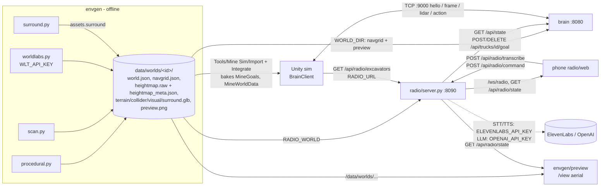

# Data schema: single source of truth

This folder holds a JSON Schema (draft 2020-12) for every piece of data that moves between envgen, the world packages, the radio, the brain and Unity. `validate.py` checks the real data against it. Prose contracts still live in `envgen/CONTRACT.md` (world package) and `spec.md` on `origin/main` (brain, sim protocol). When the schema and the prose disagree, the schema is what the validator enforces against real data. Fix the prose, or raise it with the owner.

## Data flow



The voice path runs phone → radio (STT, then the parser turns words into tool calls) → road-graph route → brain `{x,z}` goal per waypoint → brain policy → `action` to Unity → truck moves → Unity `frame` pose → brain `/api/state` → radio polls at 5 Hz → phone, `/view` and Unity excavator animation.

## Conventions

| Topic | Rule |
|---|---|
| Units | Metres, seconds and degrees. Percent fields end in `_pct`. |
| Axes | Right-handed, **Y up**, X east, Z north. Ground points are `[x, z]` (`Vec2`). 3D points are `[x, y, z]` (`Vec3`). The brain and sim use objects `{x, z}` (`XZ`). Unity maps `(x, y, z)` to `Vector3(x, y, z)` directly. |
| Heading / yaw | 0 = +z (north), clockwise positive seen from above (Unity `eulerAngles.y`), `heading = atan2(dx, dz)`. In world.json the range is `[0, 360)`. |
| Extent | `bounds = [xmin, zmin, xmax, zmax] = origin .. origin + size_m`. Never assume 400 m, 200x200 or 2 m cells. Read `size_m`, `origin`, `bounds` and the navgrid's own `width`/`height`/`cell_m`/`origin`. |
| Grids | Navgrid and heightmap are row-major. Row 0 is min z (south) and column 0 is min x (west). Navgrid `cost`: 1 = road, >1 = harder, -1 = impassable. Heightmap: `y = min + v/65535*range`. |
| Truck ids | `truck-N`, N from 0. Brain, radio and current worlds all use this. Legacy Marble worlds still carry `T1..T5`. Callsigns: world.json has `"Truck 0"`, while the radio speaks `"Truck One"` for `truck-0` (number + 1). |
| Excavator ids | `exc-N`, N from 0, one per ore face (`equipment[].face`). The radio speaks `"Excavator One"` for `exc-0`. |
| Site ids | Lowercase snake_case. They differ per world, so **look sites up by `type`** (`crusher, dump, ore, parking, fuel`). `default`: `crusher, dump_south, parking, fuel, pit_floor, pit_south, pit_west`. Scan/Marble: `ore_1..3, crusher, dump, parking, fuel`. |
| Road / junction ids | Scan/Marble: `ramp_N, haul_N, spur_N`, junctions `j_N`. Procedural: descriptive (`ramp_main_1`, `crusher_road`, `j_ramp_top`). `roads[].from/to` reference site or junction ids, and `points` run from → to. |
| Stop poses | `Pose = {pos3, heading_deg}`. `load_point` belongs to ore sites only, `dump_point` to crusher/dump only, and `slots[]` to parking only. `trucks[i]` spawns on `slots[trucks[i].slot]`. |
| Extensibility | Contracts are additive: new optional keys are allowed everywhere except where a schema says `additionalProperties: false`. Those are the radio outputs, which the radio fully controls. |

## Schema files

| File | Describes | Producer → consumers | Validated against |
|---|---|---|---|
| `common.schema.json` | `Vec2`, `Vec3`, `XZ`, `Bounds`, `HeadingDeg`, `Pose`, `SiteType`, `TruckId`, `ExcavatorId`, `Id`, `Polyline2` | shared `$defs` | (by reference) |
| `world.schema.json` | `data/worlds/<id>/world.json`. `$defs`: `Assets`, `SplatTransform`, `ScanTransform`, `ScanStats`, `MarbleInfo`, `Generator`, `Site`, `Junction`, `Road`, `Truck`, `Equipment`, `Design`, `DesignTruck`, `DesignCheck`, `NavgridCheck`, `FaceOrder`, `AsBuilt` | envgen → Unity, radio, brain, preview | every `data/worlds/*/world.json` |
| `navgrid.schema.json` | `navgrid.json` | envgen → brain planner, envgen checks | every world |
| `heightmap_meta.schema.json` | `heightmap_meta.json` (+ `heightmap.raw` layout) | envgen → Unity terrain, preview | every world |
| `radio_state.schema.json` | `GET /api/radio/state`. `$defs`: `RadioTruck`, `RadioExcavator`, `RadioEvent`, `StateMessage`, `Health` (`GET /api/radio/health`), `HelloMessage`, `PongMessage`, `WsServerMessage`, `WsClientMessage` (`/ws/radio`) | radio → phone, `/view` | live radio, plus `Radio.state_msg()` offline |
| `radio_world.schema.json` | `GET /api/radio/world` (phone minimap) | radio → phone | live radio |
| `radio_excavators.schema.json` | `GET /api/radio/excavators` | radio → Unity `MineRadioLink` | live radio |
| `radio_command.schema.json` | `POST /api/radio/command` body. `$defs`: `CommandResponse`, `Action`, `Reply`, parser `ToolCall` (`go_to`, `haul`, `return_to_parking`, `stop`, `status`, `dig`, `hold`, `exc_status`) with `GoToArgs`, `HaulArgs`, `TrucksArgs`, `ExcavatorsArgs`; `TranscribeRequest`/`TranscribeResponse`, `ReleaseResponse`, `Error` | phone → radio, parser → executor | regex parser output, `Parser.tools_schema()` arg names, `Radio.execute()` against MockBrain |
| `brain_state.schema.json` | brain `GET /api/state` (and `/ws/state`). `$defs`: `BrainTruck`, `NetRoad`, `NetSite`, `NetJunction`, `Obstacle`, `Pedestrian`, `BrainWorld` (`GET /api/world`), `BrainSites` (`GET /api/sites`). Also accepts the radio MockBrain subset | brain → radio, brain web | `origin/main` `World.snapshot()` offline; live brain if up |
| `brain_goal.schema.json` | `POST /api/trucks/{id}/goal` body `{site}` or `{x,z}`. `$defs/GoalResponse` = `BrainTruck` (also the `DELETE` response) | radio, Unity → brain | `Truck.to_dict()` offline |
| `brain_sim.schema.json` | TCP headers `hello`, `frame`, `lidar`, `actors`, `action` (a loose summary; `spec.md` is authoritative for framing and payloads) | Unity ↔ brain | (reference only) |

## Unity baked data (unity/Assets/MineSim)

- **`MineWorldData`** (Runtime) is the importer's parsed copy of world.json: sites (`pos`/`pos3`/`tonnes`), junctions, roads (`widthM`, `gradePct`, `oneWay`, `points`), trucks, `splat_transform`, `scan_transform`, heightmap meta, assets and the open `design` dictionary.
- **`MineGoals`** is baked by *Tools/Mine Sim/Integrate World Into Open Scene*, so the player does not need `data/worlds/`. It holds `worldId`, `bounds`, and per site `siteId/siteType/name/position` plus `loadPoint`/`dumpPoint` (falling back to the site position) and `slots`. It also holds `equipment` (`id/type/siteId/model/position/headingDeg/lengthM`). `MineGoals.GoalJson(p)` builds the brain body `{"x","z"}`. The parser is lenient: points may be `[x,z]`, `[x,y,z]` or `{pos3|pos|position|point|x,z}`, and headings may be `heading_deg|yaw_deg|heading|yaw`.
- **`MineDesignSpec`** flattens `design` into key/value entries (`design_truck.payload_t`, ...).
- **Scene objects**: `MineRoad` (`Road_<id>`, centreline + `WP_###` children), `MineRoadGraph` (nodes = sites + junctions, edges = roads, `one_way` honoured), `MineSiteMarker` (`Site_<id>`), `MineJunction`, `MineExcavatorRig` (dig/hold animation) and `MineGroundFollow` (keeps `TruckAgent` on the scan).
- **`MineRadioLink`** polls `GET {RADIO_URL}/api/radio/excavators` (`-radio-url` CLI > `RADIO_URL` env > inspector, http only) and drives `MineExcavatorRig`. It is read-only.
- The sim `hello` that BrainClient sends carries world.json roads/sites/junctions reduced to `x, z` (see `brain_sim.schema.json`).

## Configuration and secrets (names only)

Secret precedence in the radio is env var > `radio/secrets/<lowercase name>` > `envgen/secrets/<lowercase name>`. On `origin/main` it is env var > `<NAME>_FILE` > secret files > repo `.env`. envgen (`concepts.py`) uses env > `/run/secrets`, `envgen/secrets`, `deploy/secrets` > `deploy/.env`. Key values are never logged and never sent to browsers. `/api/radio/health` exposes booleans only.

| Name | Kind | Used by | Purpose / default |
|---|---|---|---|
| `WLT_API_KEY` | secret (`envgen/secrets/wlt_api_key`, `deploy/secrets/wlt_api_key`) | envgen worldlabs.py | World Labs Marble API (`WLT-Api-Key` header) |
| `OPENAI_API_KEY` | secret (`radio/secrets/openai_api_key`, `envgen/secrets/openai_api_key`) | radio (LLM parser, Whisper STT fallback), envgen concepts/worldlabs (concept image) | missing → regex parser |
| `ELEVENLABS_API_KEY` | secret (`radio/secrets/elevenlabs_api_key`) | radio STT (Scribe) + TTS | missing → no audio, typed commands. `origin/main` also accepts `ELEVEN_LABS_API_KEY` |
| `REACTOR_API_KEY` | secret | legacy `server/` (CONTRACT.md) | Reactor stream token exchange |
| `OPENAI_BASE_URL`, `OPENAI_MODEL` (gpt-4.1-mini), `OPENAI_STT_MODEL` (whisper-1), `OPENAI_IMAGE_MODEL` (gpt-image-1) | config | radio, envgen | |
| `ELEVENLABS_VOICE_IDS`, `ELEVENLABS_TTS_MODEL` (eleven_flash_v2_5), `ELEVENLABS_STT_MODEL` (scribe_v2) | config | radio | |
| `BRAIN_URL` | config | radio | `http://127.0.0.1:8080` |
| `RADIO_WORLD` | config | radio | path to world.json, default `data/worlds/quarry/world.json` (compose: `RADIO_WORLD_ID`) |
| `RADIO_MOCK` (`auto`/`1`/`0`), `RADIO_MOCK_SPEED`, `RADIO_LOAD_DWELL` (5 s), `RADIO_DUMP_DWELL` (4 s), `RADIO_EXC_WAIT` | config | radio | |
| `RADIO_PIN`, `RADIO_SESSION_HOURS`, `RADIO_MAX_AUDIO_KB`, `RADIO_BRAIN_ROUTING`, `RADIO_TLS`, `RADIO_LAN_IP`, `SSL_CERTFILE`, `SSL_KEYFILE` | config | radio on `origin/main` only | access code, upload cap, `{site}` goals, HTTPS |
| `HOST`, `PORT` | config | radio (127.0.0.1:8090), brain (0.0.0.0:8080) | |
| `RADIO_URL` | config | Unity MineRadioLink, `validate.py` | `http://127.0.0.1:8090` |
| `WORLD_DIR`, `SIM_PORT` (9000), `WEB_DIR`, `LIDAR_VIEWER_HZ`, `PLANNER_CKPT`, `LIDAR_HEIGHT` | config | brain | `WORLD_DIR` default `data/worlds/default` (compose: quarry) |
| `DATA_DIR` | config | envgen (`$DATA_DIR/worlds`, default `./data`), `validate.py` | `/app/data` in containers |
| `WEB_PORT`, `DOMAIN` | config | deploy/ | |

## Running the validator

```sh
envgen/.venv.nosync/bin/python schema/validate.py              # worlds + live radio/brain when reachable + brain contract
envgen/.venv.nosync/bin/python schema/validate.py --offline    # files only
uv run --with jsonschema --with fastapi --with httpx --with python-multipart --with numpy schema/validate.py
                                                               # + radio parser / execute checks (imports radio/server.py)
```

The validator only reads. Nothing is POSTed to the radio, so no TTS spend and no phone broadcast. Exit code 1 means a schema or invariant failure. WARN lines are known inconsistencies.

## Known inconsistencies (as of this schema)

1. **Legacy worlds**: `marble_pit` and `marble_draft_test` have no `bounds`, use truck ids `T1..T5` with `capacity_t` 200, and have no stop poses or excavators. They validate, but the brain and radio expect `truck-N`. Regenerate them with `worldlabs.py --from-dir` to fix. Empty world folders (`marble_draft_dusk/floor/ramp`, `marble_hifi`) have no world.json.
2. **Callsigns**: world.json `trucks[].callsign` is `"Truck 0"` for `truck-0`, while the radio speaks `"Truck One"`. The phone, preview and Unity labels can disagree.
3. **Unity equipment face**: `MineGoals.Bake` reads the excavator's site from `equipment[].site` / `site_id`, but envgen writes `equipment[].face`. `MineGoals.Equipment.siteId` therefore bakes empty for every excavator. The radio's `/api/radio/excavators` uses `face`.
4. **Goal snapping**: the radio sends `{x, z}` waypoints along world.json roads. When the sim hello carries roads, the brain snaps every `{x, z}` goal to the nearest site/junction node (`app.py post_goal`). Intermediate waypoints then turn into node goals. `origin/main`'s radio detects brain routing and sends `{site}` per leg, but this branch's radio does not.
5. **Radio branch drift**: this branch's `radio/server.py` has `/api/radio/excavators`, excavator tools and `RADIO_EXC_WAIT`. `origin/main`'s has `/api/radio/login`, `RADIO_PIN` rate limits and caps, `{site}` goals and `ELEVEN_LABS_API_KEY`, but no `/api/radio/excavators` (which Unity `MineRadioLink` polls), and its `/api/radio/world` has no `origin`/`size_m`/`basemap`. The schemas describe this branch and note main-only items.
6. **`design.notes`** is a list of strings for procedural worlds and a single string for scan worlds. The schema accepts both.
